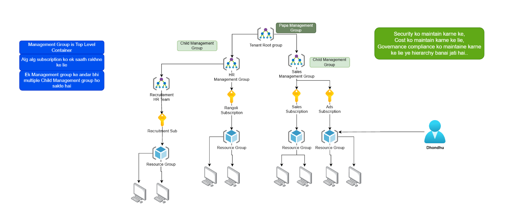
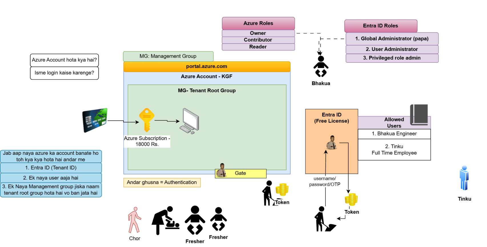
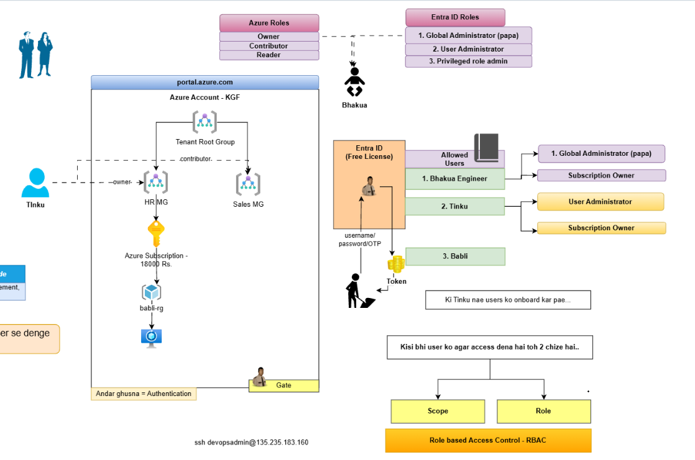
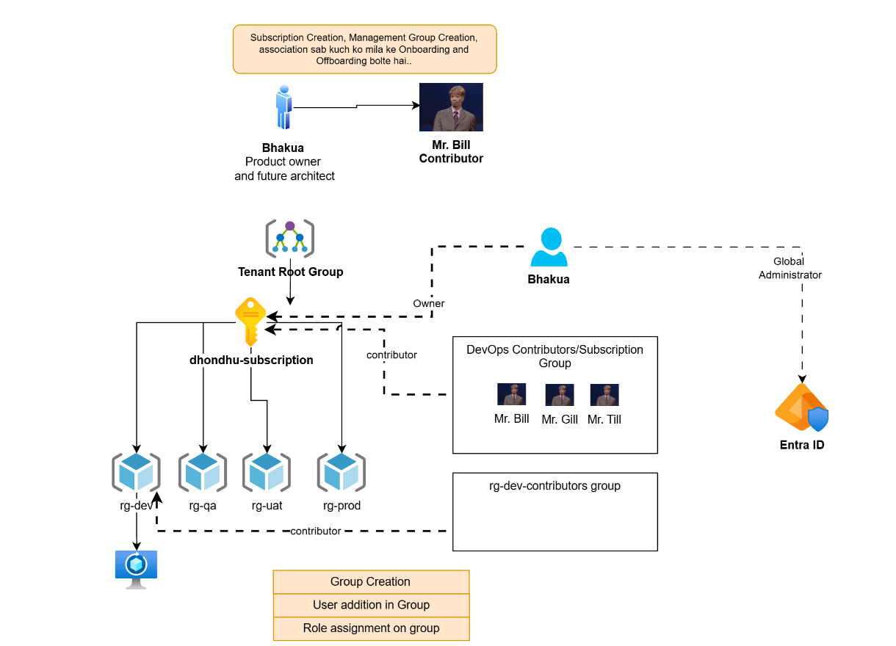
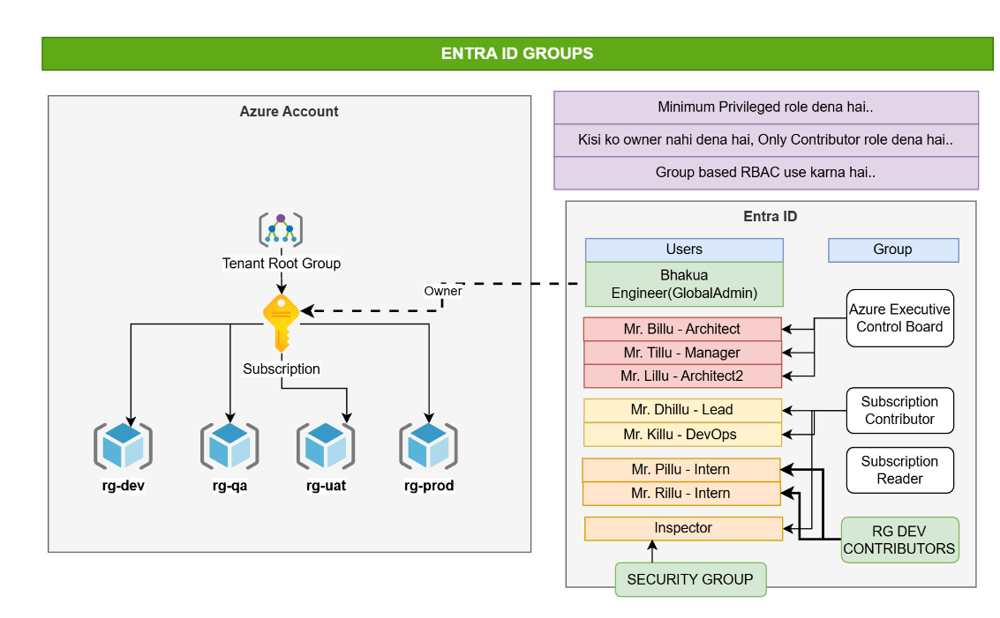

<div align="center">

# Azure Management Groups, Subscriptions, Microsoft Entra ID & RBAC

### An architecture-first guide to organizing Azure resources and controlling access at scale


**[Diagrams](#21-original-architecture-diagrams)** · **[Enterprise Example](#20-real-world-enterprise-architecture)** · **[Medium Articles](#23-my-related-medium-articles)** · **[Microsoft Learn Resources](#24-official-microsoft-learning-resources)**

</div>

---

## Table of Contents

1. [Introduction](#1-introduction)
2. [Project Overview](#2-project-overview)
3. [Learning Objectives](#3-learning-objectives)
4. [Azure Architecture Overview](#4-azure-architecture-overview)
5. [Azure Resource Hierarchy](#5-azure-resource-hierarchy)
6. [Management Groups Explained](#6-management-groups-explained)
7. [Parent and Child Management Groups](#7-parent-and-child-management-groups)
8. [Azure Subscription Management](#8-azure-subscription-management)
9. [Resource Groups Explained](#9-resource-groups-explained)
10. [Microsoft Entra ID Explained](#10-microsoft-entra-id-explained)
11. [Authentication vs Authorization](#11-authentication-vs-authorization)
12. [Azure RBAC Explained](#12-azure-rbac-explained)
13. [Azure Roles vs Entra ID Roles](#13-azure-roles-vs-entra-id-roles)
14. [Scope and Role Assignments](#14-scope-and-role-assignments)
15. [User Onboarding and Offboarding](#15-user-onboarding-and-offboarding)
16. [Group-Based RBAC](#16-group-based-rbac)
17. [Entra ID Security Groups](#17-entra-id-security-groups)
18. [Least Privilege Principle](#18-least-privilege-principle)
19. [Azure Security Best Practices](#19-azure-security-best-practices)
20. [Real-World Enterprise Architecture](#20-real-world-enterprise-architecture)
21. [Original Architecture Diagrams](#21-original-architecture-diagrams)
22. [Key Takeaways](#22-key-takeaways)
23. [My Related Medium Articles](#23-my-related-medium-articles)
24. [Official Microsoft Learning Resources](#24-official-microsoft-learning-resources)
25. [About the Author](#25-about-the-author)

---

## 1. Introduction

Every Azure environment, from a single-subscription sandbox to a multi-division enterprise, has to answer two questions:

1. **How are resources organized?** Tenant Root Group → Management Groups → Subscriptions → Resource Groups → Resources.
2. **Who can do what, and where?** Microsoft Entra ID identities → Azure RBAC roles → scopes.

This repository documents my understanding of those two questions. It is built around **five original architecture diagrams** that I drew while studying Azure and also used in my Medium articles. Each diagram is kept exactly as drawn and is accompanied by a technical explanation, with clarifications where the original diagram simplifies how Azure actually behaves.

> [!NOTE]
> **Learning and documentation project.** This repository explains concepts and architecture patterns. It does **not** contain deployed infrastructure, Infrastructure as Code, or production configuration.
>
> The diagrams are **original educational illustrations**. Names such as *KGF*, *Rangoli*, *Dhondhu*, *Bhakua* and *Tinku*, and the amount "18000 Rs.", are **fictional teaching examples**. Annotations are written in Hinglish (Hindi in English letters); an English translation is in [`docs/additional-notes.md`](docs/additional-notes.md).

---

## 2. Project Overview

| Item | Details |
|---|---|
| **Topic** | Management Groups, Subscriptions, Resource Groups, Microsoft Entra ID, Azure RBAC, Cloud Governance |
| **Format** | Five original diagrams, each with written technical explanation |
| **Focus** | Resource hierarchy, identity, authentication vs authorization, role assignment, group-based access |
| **Audience** | Azure learners, cloud and DevOps engineers, hiring managers reviewing my learning |
| **Status** | Conceptual learning documentation. No deployed resources |
| **Companion content** | [Medium articles](#23-my-related-medium-articles) |

### Repository structure

```text
azure-management-and-rbac/
│
├── README.md
│
├── images/
│   ├── 01-management-group-hierarchy.png
│   ├── 02-azure-account-and-entra-id.png
│   ├── 03-user-access-and-rbac.png
│   ├── 04-subscription-and-role-management.png
│   └── 05-entra-id-groups-and-security.png
│
└── docs/
    └── additional-notes.md
```

---

## 3. Learning Objectives

- Explain how a **tenant**, **Tenant Root Group**, **management groups**, **subscriptions**, **resource groups** and **resources** fit together.
- Distinguish a **Microsoft Entra ID tenant** from an **Azure subscription**.
- Distinguish **authentication** (who you are) from **authorization** (what you may do).
- Distinguish **Azure RBAC roles** (Owner, Contributor, Reader) from **Microsoft Entra roles** (Global Administrator, User Administrator, Privileged Role Administrator).
- Build a **role assignment** from three parts: *who* + *which role* + *which scope*.
- Apply **group-based RBAC** and **least privilege** instead of assigning roles to individuals.
- Describe how users are **onboarded and offboarded** across identity, access and organization layers.

---

## 4. Azure Architecture Overview

Azure separates **identity** from **resource organization**. Azure RBAC connects the two.

| Plane | Component | Responsibility |
|---|---|---|
| **Identity** | Microsoft Entra ID tenant | Users, groups, authentication, directory roles |
| **Organization** | Tenant Root Group → Management Groups → Subscriptions → Resource Groups | Governance, billing boundaries, resource lifecycle |
| **Access** | Azure RBAC | Connects an identity to a role at a scope |

```text
        ┌──────────────────────────────────────┐
        │  Microsoft Entra ID tenant           │  ← Identity: who you are
        │  users · groups · Entra roles        │
        └──────────────────┬───────────────────┘
                           │ trusted by
                           ▼
        ┌──────────────────────────────────────┐
        │  Tenant Root Group                   │  ← Organization: where things live
        │  └─ Management Groups                │
        │     └─ Subscriptions                 │
        │        └─ Resource Groups            │
        │           └─ Resources               │
        └──────────────────┬───────────────────┘
                           │
              Azure RBAC role assignment            ← Access: what you can do, and where
```

---

## 5. Azure Resource Hierarchy

| Level | What it is | Typical purpose |
|---|---|---|
| **Tenant Root Group** | Top-level management group of the Entra tenant | Governance and access that must reach every subscription |
| **Management Group** | Container for subscriptions and child management groups | Group subscriptions by business unit, environment or compliance need |
| **Subscription** | Billing, access and limits/quota boundary | Isolate teams, workloads or environments |
| **Resource Group** | Logical container for resources that share a lifecycle | Deploy, manage and delete related resources together |
| **Resource** | A single service instance (VM, storage account, and so on) | The actual workload components |

**Inheritance:** access and governance applied at a higher level flow **downward** to everything beneath it.

---

## 6. Management Groups Explained

A **management group** is a container **above subscriptions**. It lets you apply governance (Azure Policy) and access control (Azure RBAC) to many subscriptions at once.

- It can contain **subscriptions and other (child) management groups**, but not resources directly.
- Role assignments and policies applied to it are **inherited** by everything below.
- As my Diagram 1 notes, the hierarchy supports **security, cost organization, and governance/compliance**.

> [!NOTE]
> **Clarification of Diagram 1.** The diagram says a management group is the "top level container". More precisely, the **Tenant Root Group** is the top-level management group, and other management groups sit beneath it. For **cost**, management groups provide organizational structure; spend itself is tracked per subscription and resource group, typically with tags and Microsoft Cost Management.

### Management Group vs Resource Group

| Aspect | Management Group | Resource Group |
|---|---|---|
| Contains | Subscriptions and child management groups | Azure resources |
| Position | **Above** subscriptions | **Below** subscriptions |
| Purpose | Governance and access at scale | Lifecycle of related resources |
| Holds resources directly | No | Yes |
| Example | `HR MG`, `Sales MG` | `rg-dev`, `rg-prod` |

---

## 7. Parent and Child Management Groups

Diagram 1 uses a family analogy: the Tenant Root Group is the "Papa" (parent) and the groups below it are children.

| Rule | Explanation |
|---|---|
| One parent | Each management group (except the root) and each subscription has exactly **one** parent management group |
| Many children | A management group can have multiple child management groups and subscriptions |
| Depth limit | Up to **six levels** of depth, not counting the root level or the subscription level |
| Root is permanent | The Tenant Root Group cannot be deleted or moved |
| Inheritance | Anything assigned at a parent applies to all descendants |

---

## 8. Azure Subscription Management

A **subscription** ties resources to **billing** and provides an **access and limits boundary**.

- A subscription trusts **exactly one** Microsoft Entra tenant; one tenant can have **many** subscriptions.
- New subscriptions are placed under the **Tenant Root Group** by default and can then be moved to another management group.
- Moving a subscription between management groups changes which inherited policies and role assignments apply to it.

### Tenant vs Subscription

| Aspect | Microsoft Entra ID Tenant | Azure Subscription |
|---|---|---|
| Role | Identity directory (users, groups, apps) | Billing and resource container |
| Identifier | Tenant ID | Subscription ID |
| Contains | Identities and directory objects | Resource groups and resources |
| Governed by | Entra roles (directory tasks) | Azure RBAC (resource tasks) |
| Relationship | One tenant → many subscriptions | Each subscription → one trusted tenant |

> [!NOTE]
> **"Azure Account" is a teaching label.** Diagram 2 uses "Azure Account - KGF" as one box. In Microsoft's terms, you sign in as an identity in an Entra tenant, and the billing and resource boundary is the subscription. The three items listed in Diagram 2 (a tenant, a first user, and the Tenant Root Group) are a good mental model. Technically, the root management group appears once management groups are first used in the tenant, so treat it as always present conceptually.

---

## 9. Resource Groups Explained

- Every resource belongs to **exactly one** resource group.
- Resources in a group usually share a **lifecycle**: deployed, updated and deleted together.
- A resource group lives **inside one subscription**.
- RBAC at resource group scope gives narrow access, for example only to the development environment.

My diagrams use resource groups to separate environments: `rg-dev`, `rg-qa`, `rg-uat`, `rg-prod`, plus a workload group, `babli-rg`.

---

## 10. Microsoft Entra ID Explained

**Microsoft Entra ID** (formerly Azure Active Directory) is Microsoft's cloud identity and access management service and the **identity provider** for Azure.

- A **tenant** is a dedicated instance of Entra ID for an organization, identified by a **Tenant ID**.
- It stores **users** and **groups** and performs **authentication**.
- The diagrams show a tenant on the **Free** license, which covers basic user and group management.

---

## 11. Authentication vs Authorization

| | Authentication (AuthN) | Authorization (AuthZ) |
|---|---|---|
| Question | Who are you? | What are you allowed to do? |
| Handled by | Microsoft Entra ID | Azure RBAC (for Azure resources) |
| Inputs | Username, password, OTP/MFA | Role + scope |
| Result | A **token** proving identity | Actions allowed or denied |
| Diagram metaphor | The **Gate**: "Andar ghusna = Authentication" (*entering = authentication*) | What you may do once inside |

**Flow shown in Diagrams 2 and 3**

1. A user opens `portal.azure.com`.
2. The user signs in with username, password and OTP against Entra ID.
3. On success the user receives a **token**.
4. Azure evaluates **RBAC role assignments** to decide what that identity can do.

> [!IMPORTANT]
> A user can sign in successfully and still see **nothing** in Azure. Authentication succeeded, but with no role assignment there is no authorization to any resource.

---

## 12. Azure RBAC Explained

**Azure role-based access control (RBAC)** is the authorization system for Azure resources. Diagram 3 summarizes it: *to give any user access you need two things, **Scope** and **Role**.* In full, a role assignment has three parts:

| Part | Question | Example |
|---|---|---|
| **Security principal** | Who? | A user, group, service principal or managed identity |
| **Role definition** | What can they do? | Owner, Contributor, Reader |
| **Scope** | Where does it apply? | Management group, subscription, resource group, resource |

### Core built-in roles

| Role | Manage resources | Assign roles to others | Typical use |
|---|---|---|---|
| **Owner** | Full access | **Yes** | A very small set of trusted administrators |
| **Contributor** | Create and manage all resource types | **No** | Engineers and DevOps teams |
| **Reader** | View only | No | Auditors, stakeholders |

> [!IMPORTANT]
> **Contributor cannot grant access.** Only roles with role-assignment permissions, such as Owner or User Access Administrator, can create role assignments. That is why Contributor is the safer default for engineers.

---

## 13. Azure Roles vs Entra ID Roles

These are **two separate role systems**. Both appear at the top of Diagrams 2 and 3.

| Aspect | Azure RBAC roles | Microsoft Entra roles |
|---|---|---|
| **Manage what** | Azure **resources** (VMs, networks, storage) | The **directory**: users, groups, app registrations, tenant settings |
| **Examples** | Owner, Contributor, Reader | Global Administrator, User Administrator, Privileged Role Administrator |
| **Scope** | Management group, subscription, resource group, resource | Tenant (or an administrative unit) |
| **Managed in** | Access control (IAM) blade | Microsoft Entra admin center → Roles and administrators |

### Entra roles shown in the diagrams

| Role | Purpose |
|---|---|
| **Global Administrator** | Highest directory privilege; can manage almost all aspects of Entra ID |
| **User Administrator** | Creates and manages users and groups, the role relevant to onboarding |
| **Privileged Role Administrator** | Manages role assignments in Entra ID and Privileged Identity Management |

### Global Administrator vs Subscription Owner

| | Global Administrator | Subscription Owner |
|---|---|---|
| System | Microsoft Entra roles | Azure RBAC |
| Controls | The directory | Everything in one subscription, including granting access |
| Automatic access to the other? | **No** | **No** |

> [!WARNING]
> A Global Administrator does **not** automatically have access to Azure subscriptions. They can **elevate access** to manage all subscriptions and management groups in the tenant, but that is a deliberate, auditable action. Conversely, an Azure Owner cannot create Entra users unless they also hold a suitable Entra role.

---

## 14. Scope and Role Assignments

Scopes are hierarchical, and assignments **inherit downward**:

```text
Management Group     ← broadest
   └─ Subscription
        └─ Resource Group
             └─ Resource     ← narrowest
```

| Scope | Effect of Contributor assigned here |
|---|---|
| Management group | All subscriptions beneath it |
| Subscription | All resource groups and resources in it |
| Resource group | Only resources in that group |
| Resource | Only that single resource |

### Assignments shown in my diagrams

| Diagram | Assignment |
|---|---|
| 3 | **Tinku**: Owner at **HR MG**, Contributor at **Sales MG** |
| 4 | **Bhakua**: Owner on **dhondhu-subscription** |
| 4 | **DevOps Contributors** group: Contributor on the subscription |
| 4 | **rg-dev-contributors** group: Contributor on `rg-dev` |
| 5 | **Bhakua Engineer (Global Admin)**: Owner on the subscription |

> [!TIP]
> Choose the **narrowest scope** that lets someone do their job. A developer who only works in `rg-dev` should be assigned at `rg-dev`, not the subscription.

---

## 15. User Onboarding and Offboarding

Diagram 4 notes that subscription creation, management group creation and the association between them together make up onboarding and offboarding of a team or workload. Applied to a person, the lifecycle looks like this:

| Stage | Identity (Entra ID) | Access (Azure RBAC) | Organization |
|---|---|---|---|
| **Onboarding** | Create the user (needs a role such as User Administrator) | Add the user to the right **group**; the group already holds the role at the right scope | Workload subscription already sits under the right management group |
| **Role change** | Move the user between groups | Access changes through group membership | No change |
| **Offboarding** | Remove from groups; disable or delete the account | Access ends with group membership | Retire or move the subscription if the whole team is dissolved |

> [!NOTE]
> Diagram 3's note ("so that Tinku can onboard users") reflects that onboarding is an **Entra directory task**. It needs an Entra role such as **User Administrator**; an Azure Owner assignment alone does not provide it.

---

## 16. Group-Based RBAC

Diagram 4 shows the three-step pattern:

```text
1. Group creation            → create a security group in Microsoft Entra ID
2. User addition in group    → add people who need the same access
3. Role assignment on group  → assign the Azure role to the group at the right scope
```

| Direct user assignments | Group-based assignments |
|---|---|
| One assignment per person per scope | One assignment per group per scope |
| Hard to audit as teams grow | Easy to review: "who is in this group?" |
| Offboarding means hunting down every assignment | Offboarding means removing group membership |
| Role sprawl and mistakes | Consistent, repeatable model |

> [!TIP]
> Azure also limits the number of role assignments per subscription. Assigning to groups keeps you far from that limit.

---

## 17. Entra ID Security Groups

A **security group** is an Entra ID group used to grant access to resources. Members can be users, other groups, devices or service principals. A role assigned to the group applies to every member.

### Groups shown in Diagrams 4 and 5

| Group | Members shown | Role and scope |
|---|---|---|
| **DevOps Contributors / Subscription Group** (D4) | Mr. Bill, Mr. Gill, Mr. Till | Contributor on `dhondhu-subscription` |
| **rg-dev-contributors** (D4) | Not shown | Contributor on `rg-dev` |
| **Azure Executive Control Board** (D5) | Billu (Architect), Tillu (Manager), Lillu (Architect2) | Role not labeled in the diagram |
| **Subscription Contributor** (D5) | Dhillu (Lead), Killu (DevOps) | Contributor at subscription scope (implied by name) |
| **Subscription Reader** (D5) | Not shown | Reader at subscription scope (implied by name) |
| **RG DEV CONTRIBUTORS** (D5) | Pillu, Rillu (Interns) | Contributor on `rg-dev` (implied by name) |
| **SECURITY GROUP** (D5) | Inspector | Role not labeled in the diagram |

> [!NOTE]
> Where a diagram does not label a role or membership, this table says so rather than guessing.

---

## 18. Least Privilege Principle

Diagram 5 states three rules at the top, which together express least privilege:

| Rule in the diagram | Professional interpretation |
|---|---|
| "Minimum privileged role dena hai" | Grant only the permissions required for the task |
| "Kisi ko Owner nahi dena hai, only Contributor" | Keep Owner for a very small trusted set; give engineers Contributor |
| "Group based RBAC use karna hai" | Assign roles to groups, not individuals |

Interns in Diagram 5 receive Contributor only on `rg-dev`, a direct application of the principle: smallest role, narrowest scope, via a group.

---

## 19. Azure Security Best Practices

Beyond what the diagrams show, these are widely recommended Azure practices (verify against current [Microsoft Learn guidance](#24-official-microsoft-learning-resources)):

- Assign access at the **narrowest scope** that works: resource group before subscription before management group.
- Keep **Global Administrator** assignments few, and use separate accounts for daily work and privileged work.
- Require **MFA**, especially for administrators.
- Prefer **just-in-time** privileged access with Microsoft Entra Privileged Identity Management (licensing applies) over permanent elevated roles.
- Run **access reviews** to remove stale assignments and group members.
- Keep **more than one** trusted owner or administrator so access never depends on one person.
- Give `prod` the tightest access; separate `dev`, `qa`, `uat` and `prod`.
- Use **Azure Policy** at management group level for guardrails such as allowed regions and required tags.

> [!NOTE]
> Diagram 5 shows a single Owner. That illustrates "very few owners"; real organizations usually keep a second one for continuity.

---

## 20. Real-World Enterprise Architecture

> [!NOTE]
> This is a **conceptual design** based on Diagram 1 and the access model in Diagrams 4 and 5. It is **not** a deployed environment.

```text
Tenant Root Group
│
├── HR Management Group
│   ├── Recruitment Management Group
│   │   └── Recruitment Subscription
│   │       └── Resource Groups
│   └── HR Subscription (named "Rangoli" in Diagram 1)
│       └── Resource Groups
│
└── Sales Management Group
    ├── Sales Subscription
    │   └── Resource Groups
    └── Ads Subscription
        └── Resource Groups
```

### How the pieces work together

| Component | Role in the design |
|---|---|
| **Management groups** | Separate business units so each gets its own governance and access rules |
| **Subscriptions** | Billing and isolation boundary per team or workload |
| **Resource groups** | Group resources by workload or environment (`rg-dev`, `rg-prod`) |
| **Microsoft Entra ID** | Holds employee identities and authenticates them |
| **Security groups** | Collect users by function, for example "Sales Subscription Contributors" |
| **Azure RBAC and role assignments** | Bind each group to a role at a scope |
| **Scope** | Decides how far each assignment reaches |
| **Least privilege** | Keeps each role and scope as small as the job allows |

### Example access design (conceptual)

| Who (Entra group) | Role | Scope | Why |
|---|---|---|---|
| Sales cloud engineers | Contributor | Sales Subscription | Build and manage workloads, cannot grant access |
| Ads engineers | Contributor | Ads resource group(s) | Narrower, limited to one workload |
| Auditors | Reader | HR Management Group | View-only across all HR subscriptions |
| Platform administrators (very few) | Owner | Subscription or management group | Manage access and governance |
| Identity administrators | *Entra role:* User Administrator | Tenant | Onboard and manage users and groups |

### End-to-end flow

1. A new Sales engineer joins; an identity administrator **creates the user** in Entra ID.
2. The user is **added to the Sales engineers group**.
3. That group already holds **Contributor on the Sales Subscription**, so no per-user assignment is needed.
4. The user signs in (**authentication**), receives a token, and Azure evaluates RBAC (**authorization**).
5. When the engineer leaves, removing them from the group and disabling the account ends their access.

---

## 21. Original Architecture Diagrams

> [!NOTE]
> These are my original educational diagrams, shown unmodified. Names are fictional. Hinglish annotations are translated in [`docs/additional-notes.md`](docs/additional-notes.md).

### Diagram 1: Azure Management Group Hierarchy



**Introduction.** How Azure resources are organized beneath the Tenant Root Group.

**Technical explanation.** Two child management groups, **HR** and **Sales**, hang from the root. HR contains a child management group (**Recruitment HR Team**) and a subscription (**Rangoli**). Sales contains two subscriptions (**Sales** and **Ads**). Each subscription holds a resource group containing virtual machines. A user (**Dhondhu**) is connected to the Ads resource group.

**Important concepts.** Tenant Root Group; parent and child management groups; subscriptions grouped under management groups; subscription → resource group → resource nesting; downward inheritance.

**Enterprise use case.** A compliance team applies HR-specific policy once at the HR management group and it covers both the Recruitment and Rangoli subscriptions, while Sales and Ads stay under a separate governance umbrella.

**Key learning points.**
- Management groups organize subscriptions; resource groups organize resources.
- Governance and access flow from parent to child.
- The hierarchy supports security, cost organization and compliance.

> [!TIP]
> **Accuracy note.** The Tenant Root Group, not a generic management group, is the true top level. See [Management Groups Explained](#6-management-groups-explained).

---

### Diagram 2: Azure Account, Microsoft Entra ID and the Authentication Flow



**Introduction.** Answers "What is an Azure account and how do you log in?"

**Technical explanation.** A new environment brings a **Microsoft Entra ID tenant**, a **new user** and the **Tenant Root Group**. A subscription (card-paid, illustrative amount) sits under the root and contains a VM. On the right, **Entra ID (Free license)** lists allowed users (*Bhakua Engineer*, *Tinku, full-time employee*). Users present username, password and OTP, and receive a **token**. The **Gate** represents authentication; the thief and freshers outside lack valid credentials. At the top, **Azure roles** (Owner, Contributor, Reader) are contrasted with **Entra ID roles** (Global Administrator, User Administrator, Privileged Role Administrator).

**Important concepts.** Tenant, first user, root management group; Entra ID as identity provider; credentials in, token out; subscription as a billing container; two distinct role systems.

**Enterprise use case.** A new organization signs up, the first administrator signs in through Entra ID and creates further users. Only valid identities pass the gate; what they can do depends on their roles.

**Key learning points.**
- Identity lives in the tenant; billing lives in the subscription.
- Authentication proves identity, nothing more.
- Azure roles and Entra roles are different things.

> [!TIP]
> **Accuracy note.** "Azure Account" is a teaching label, and signing in does not grant resource access; RBAC does.

---

### Diagram 3: User Access, Scope and Role (RBAC)



**Introduction.** Turns the Diagram 2 setup into concrete role assignments.

**Technical explanation.** **Tinku** has **Owner** on **HR MG** and **Contributor** on **Sales MG**. HR MG holds a subscription with resource group `babli-rg` and a VM. In Entra ID, **Bhakua Engineer** is Global Administrator and Subscription Owner, **Tinku** is User Administrator and Subscription Owner, and **Babli** is a third allowed user. A note explains Tinku holds User Administrator so he can onboard users. The summary box states that access needs two things: **Scope** and **Role**.

**Important concepts.** Scope + Role; assignment at management group scope; different roles at different scopes for one user; Entra roles beside Azure roles.

**Enterprise use case.** A team lead gets full control of HR resources and build-only access to Sales without touching individual subscriptions, plus User Administrator to onboard teammates.

**Key learning points.**
- A role assignment always has a scope.
- Owner on a management group reaches every subscription beneath it.
- Directory tasks need Entra roles, not Azure roles.

> [!TIP]
> **Accuracy note.** In practice prefer subscription or resource group scope over management group Owner.

---

### Diagram 4: Subscription Management and Group-Based Role Assignment



**Introduction.** Shows one subscription with environments and group-based access.

**Technical explanation.** **dhondhu-subscription** sits under the Tenant Root Group with `rg-dev`, `rg-qa`, `rg-uat` and `rg-prod`. **Bhakua** (product owner and future architect) is Global Administrator in Entra ID and **Owner** of the subscription. A **DevOps Contributors / Subscription Group** (Mr. Bill, Mr. Gill, Mr. Till) has **Contributor** on the subscription, and an **rg-dev-contributors** group has **Contributor** only on `rg-dev`. The bottom box lists the pattern: group creation, user addition, role assignment on the group.

**Important concepts.** Environment-based resource groups; Owner vs Contributor; Global Administrator vs Owner; group-based RBAC at two scopes.

**Enterprise use case.** A product team shares one subscription. The DevOps team contributes broadly, while a smaller group works only in development. Group membership changes take effect on access without editing role assignments.

**Key learning points.**
- Assign roles to groups, not people.
- Narrower groups get narrower scopes.
- Global Administrator and Owner belong to different systems.

> [!TIP]
> **Accuracy note.** The people share one avatar image, so read groups by label, not by picture.

---

### Diagram 5: Microsoft Entra ID Groups and Security Principles



**Introduction.** Brings the whole access model together in one view.

**Technical explanation.** The left shows a subscription with four environment resource groups. The right shows the Entra tenant with users and groups. **Bhakua Engineer (Global Admin)** is Owner of the subscription. Users are organized by function: **Azure Executive Control Board** (Billu, Tillu, Lillu), **Subscription Contributor** (Dhillu, Killu), **Subscription Reader**, **RG DEV CONTRIBUTORS** (Pillu, Rillu, interns) and a **Security Group** (Inspector). Three principles head the diagram: minimum privileged role, no Owner for everyone (Contributor only), and group-based RBAC.

**Important concepts.** Groups mapped to job functions; security groups for access control; least privilege; Owner reserved for very few; interns limited to `rg-dev`.

**Enterprise use case.** Leads and DevOps engineers get Contributor on the subscription, interns get Contributor only on development, reviewers get Reader. A responsibility change means a group membership change.

**Key learning points.**
- Design access by job function.
- Smallest role, narrowest scope, assigned through groups.
- Keep Owner rare.

> [!TIP]
> **Accuracy note.** Roles for *Azure Executive Control Board* and *Subscription Reader*, and some arrows for *Inspector*, are not labeled in the diagram, so they are described as shown.

---

## 22. Key Takeaways

1. **Identity and organization are separate.** Entra ID answers *who*; the hierarchy answers *where*.
2. **Authenticate first, authorize second.** A valid token alone grants no resource access.
3. **Tenant ≠ Subscription.** One tenant can be trusted by many subscriptions; each subscription trusts one tenant.
4. **Management groups sit above subscriptions; resource groups sit below.**
5. **Azure RBAC ≠ Entra roles.** One governs resources, the other the directory.
6. **Access = who + role + scope.**
7. **Inheritance flows downward.** Use the narrowest scope that works.
8. **Prefer groups over individuals, Contributor over Owner, least privilege over convenience.**

---

## 23. My Related Medium Articles

I publish my Azure learning notes on Medium. These three articles accompany the diagrams in this repository.

| Article | Topic | Description | Link |
|---|---|---|---|
| **Understanding Azure Management Group Hierarchy: From Tenant Root to Resources** | Management groups and hierarchy | Walks through the structure from the Tenant Root Group down to resources. Companion to Diagram 1. | [Read Article](https://medium.com/@aniketkmr484/understanding-azure-management-group-hierarchy-from-tenant-root-to-resources-48b62324e115) |
| **What Happens When You Create an Azure Account? Understanding Entra ID, Authentication & Authorization** | Entra ID, authentication and authorization | Explains what is created with a new Azure account and how sign-in and access differ. Companion to Diagram 2. | [Read Article](https://medium.com/@aniketkmr484/what-happens-when-you-create-an-azure-account-184dd1d4457a) |
| **Azure RBAC Explained: How to Give Users Access to Azure Resources** | Azure RBAC | Covers roles, scope and role assignments for giving users access. Companion to Diagrams 3 to 5. | [Read Article](https://medium.com/@aniketkmr484/azure-rbac-explained-how-to-give-users-access-to-azure-resources-191cb291cc18) |

**More from me:** [medium.com/@aniketkmr484](https://medium.com/@aniketkmr484)

---

## 24. Official Microsoft Learning Resources

| Topic | Link |
|---|---|
| Management groups | [Microsoft Learn: Management groups overview](https://learn.microsoft.com/azure/governance/management-groups/overview) |
| Resource Manager and resource groups | [Azure Resource Manager overview](https://learn.microsoft.com/azure/azure-resource-manager/management/overview) |
| Organizing subscriptions | [Cloud Adoption Framework: Organize subscriptions](https://learn.microsoft.com/azure/cloud-adoption-framework/ready/azure-best-practices/organize-subscriptions) |
| Azure RBAC | [What is Azure RBAC?](https://learn.microsoft.com/azure/role-based-access-control/overview) |
| RBAC best practices | [Best practices for Azure RBAC](https://learn.microsoft.com/azure/role-based-access-control/best-practices) |
| Azure vs Entra roles | [Azure roles, Entra roles and classic administrator roles](https://learn.microsoft.com/azure/role-based-access-control/rbac-and-directory-admin-roles) |
| Microsoft Entra ID | [What is Microsoft Entra ID?](https://learn.microsoft.com/entra/fundamentals/whatis) |
| Entra built-in roles | [Microsoft Entra built-in roles](https://learn.microsoft.com/entra/identity/role-based-access-control/permissions-reference) |
| Groups | [Learn about groups and access rights](https://learn.microsoft.com/entra/fundamentals/concept-learn-about-groups) |
| Elevating access | [Elevate access to manage all subscriptions](https://learn.microsoft.com/azure/role-based-access-control/elevate-access-global-admin) |

> [!NOTE]
> Microsoft occasionally reorganizes documentation URLs. If a link redirects or breaks, search the topic title on Microsoft Learn.

---

## 25. About the Author

**Aniket Kumar**

I document my Azure and DevOps learning through architecture diagrams, practical examples and technical articles, using GitHub and Medium to explain what I study in a clear, structured way.

<p>
  <a href="https://www.linkedin.com/in/aniket484">
    
  </a>
  <a href="https://github.com/aniket-devop">
    
  </a>
  <a href="https://medium.com/@aniketkmr484">
    
  </a>
</p>

Spotted a technical inaccuracy or have a suggestion? Please open an issue. Feedback is welcome.
